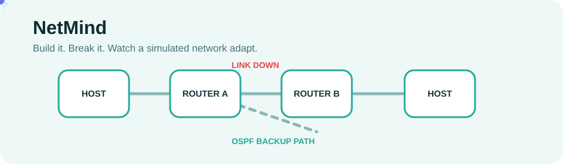
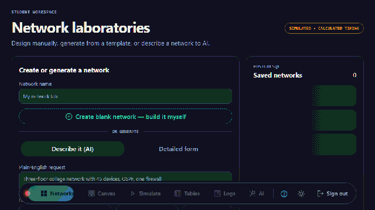
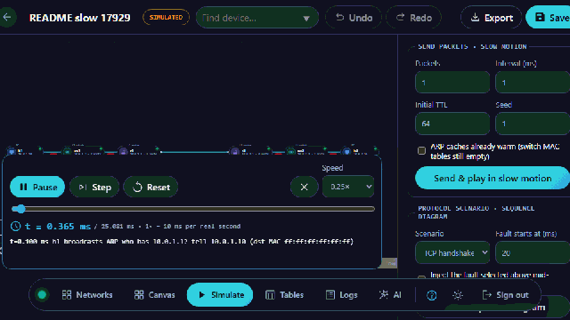
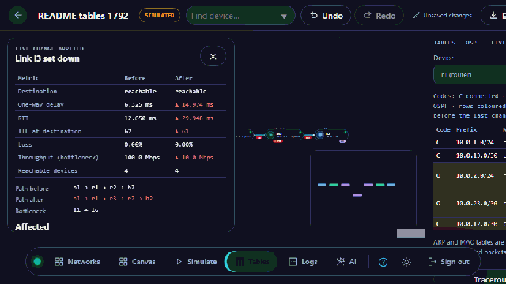
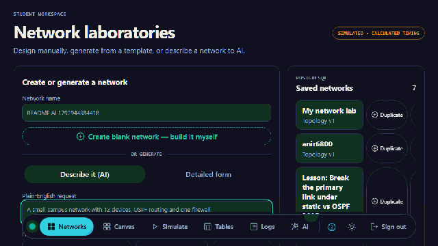
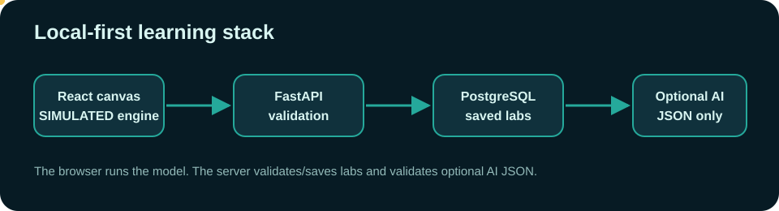
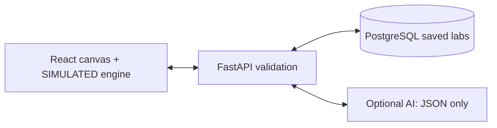

<picture>
  <source media="(prefers-color-scheme: dark)" srcset="assets/readme/hero-dark.svg">
  
</picture>

# NetMind

**A local-first network behaviour lab where students build a topology, break it deliberately, and inspect the simulated consequences—from packets to routing tables.**

<p>
  
  
  
  
</p>

## Why NetMind is different

- One calculation path powers fault preview, live changes, slow-motion playback, routing tables, and tests—so a student can compare a prediction against the applied result.
- It makes the invisible visible: per-hop delay terms, layer-by-layer packet handling, converging routes, and the impact of critical devices are all inspectable.
- Optional AI is constrained to validated JSON, grounded explanations, and preview-then-confirm suggestions. It never executes model output.

### What it is not

NetMind is **not Cisco Packet Tracer**, not a replacement for a vendor lab, and not vendor-accurate network emulation. Every path, delay, packet, timer, convergence result, and AI-assisted topology shown in the app is **SIMULATED** for learning. No real packets leave the browser.

## Quick start in 60 seconds

1. Start Docker Desktop, then double-click [run.bat](run.bat). On a free machine it opens `http://127.0.0.1:5173`; if that port is occupied, the launcher reports and uses `5174`.
2. Sign in with a local Firebase-emulator account, or use **Create account**. The documented seeded account is `student@netmind.local` / `NetMindDemo!2026`, but that specific login was **NOT VERIFIED** in this recording session; **Create account** was verified. Nothing is hosted publicly.
3. Choose a prepared lab, create a blank canvas, or describe a topology. The first screen to explore is the bottom drawer: **Canvas · Simulate · Tables · Logs · AI**.

The launcher needs a clean, local NetMind demo database to seed the legacy `demo` record. If an existing database already has a conflicting record, see [Troubleshooting](#troubleshooting) before using a destructive reset.

## See it in 20 seconds



*Choose a prepared lab, right-click a link, and see a **SIMULATED** before/after impact card. The recording is from the real app.*



*Play a **SIMULATED** packet hop by hop, pause it, and inspect encapsulation plus per-hop timing.*



*A live **SIMULATED** link change highlights routing-table diffs and compares Static, RIP, and OSPF convergence.*



*Ask for a topology. The result always shows its source—configured NVIDIA AI or a labelled local fallback—and is validated before it is drawn.*

## Feature tour

| Explore | What you can do |
| --- | --- |
| Build or generate | Drag eight device types onto a canvas, connect them, edit interfaces, or start from one of 25 prepared labs. Natural-language generation is optional; the detailed form needs no AI. |
| Break and restore | Right-click a device or link to take it down or restore it. The before/after card reports simulated reachability, path, delay, RTT, loss, throughput, and affected layers. |
| Slow-motion layers | Run ICMP, ARP, DHCP, DNS, TCP, UDP, or HTTP scenarios against a discrete-event virtual clock; pause, step, scrub, and inspect a packet. |
| Routing and convergence | Compare live routing-table diffs, traceroute, Static/RIP/OSPF timelines, and the resulting simulated outage. |
| Criticality | Find articulation points, bridge links, betweenness, and which devices lose reachability if a device or link fails. |
| Explain and suggest | Get a source-labelled explanation or an allowlisted suggestion. A suggestion only changes a network after a preview and explicit Apply. |

## Architecture





The topology is a versioned JSON graph: named nodes, typed interfaces, links, states, capacities, delays, and optional queue/load fields. PostgreSQL stores named labs and topology JSON; the browser computes routes, timing, packets, tables, convergence, and criticality from that graph.

| Layer | Implementation | Responsibility |
| --- | --- | --- |
| Canvas and simulation | React 19, TypeScript, React Flow | Editing, virtual-clock packet playback, routing/timing model, analysis, and accessibility UI |
| API | FastAPI, Pydantic, SQLAlchemy | Schema validation, saved networks/templates, import/export, and AI-output validation |
| Storage | PostgreSQL + Alembic | Local saved labs and migrations |
| Local sign-in | Firebase Auth emulator | Local accounts only |
| Optional AI | NVIDIA OpenAI-compatible endpoint | Structured topology/explain/suggest data; unavailable calls fall back to labelled local rules |

## How the simulation works

The model is deterministic for the same topology, fault, and seed. It has an analytical calculator for preview/live impact and a discrete-event virtual clock for packet playback. RIP/OSPF timers and route changes are educational models documented in [docs/sim_model.md](docs/sim_model.md).

For a packet of $B$ bytes over a link of capacity $C$ Mbps and length $d$ metres:

$$
t_{tx} = \frac{B \times 8}{C \times 10^6}
$$

$$
t_{prop} = \frac{d}{2 \times 10^8}
$$

$$
t_{queue} = \frac{\rho}{1-\rho} \times t_{tx}
$$

$$
t_{hop} = t_{proc} + t_{queue} + t_{tx} + t_{prop}
\qquad\text{and}\qquad
RTT = \sum t_{hop}^{forward} + \sum t_{hop}^{return}
$$

Worked example from the current unit test: a 1,500-byte packet over a 10 Mbps, 2 km link has $t_{tx}=1.2\,ms$ and $t_{prop}=0.01\,ms$. The same test also checks a 50% utilised, two-packet M/M/1/K queue: $t_{queue}=1.2\,ms$. These are **SIMULATED calculations**, not wire measurements.

What is deliberately **not** modelled: vendor CLIs/defaults, spanning tree, VLANs, NAT, IPv6, physical collisions/attenuation/radio effects, complete TCP, real capture, or real traffic generation. See the full limits in [docs/sim_model.md](docs/sim_model.md#6-not-modelled).

## Quality and safety

Current local verification:

- Backend: **177 passed** with `python -m pytest -q`; Ruff passes.
- Frontend: **129 passed** with `npm test`; production build passes.
- 50-device Node/V8 measurements on this machine: `compareImpact` 15.846 ms, OSPF convergence 21.4 ms, RIP convergence 47.781 ms, 20-packet discrete-event run 7.672 ms, criticality summary 1.977 ms. These are calculator timings, **not browser FPS or real-network latency**.
- Optional provider keys stay in ignored `.env`; the browser never receives them. Provider output is parsed as data, validated against topology constraints/known simulation facts, and never executed as a command.

```powershell
cd backend; ..\.venv\Scripts\python.exe -m pytest -q; ..\.venv\Scripts\python.exe -m ruff check .
cd ..\frontend; npm test; npm run build
# With the local stack running:
npx playwright test
```

## Details

<details>
<summary><strong>All 25 prepared labs</strong></summary>

College campus, Campus ring, Small office, Enterprise HQ, Data centre, ISP backbone, Smart home, Wireless mesh, Branch WAN, Hospital, School lab, Hotel Wi-Fi, Industrial plant, Retail chain, Bank network, Hybrid cloud, IoT deployment, VoIP office, Security lab, RIP practice, OSPF practice, Legacy LAN, Complexity 1: small, Complexity 2: medium, and Complexity 3: large. They range from 9 to 50 devices and are deterministic templates—not hand-drawn vendor configurations.
</details>

<details>
<summary><strong>Device types and symbols</strong></summary>

Host, server, router, firewall, switch, access point, hub, and repeater. Hubs/repeaters are L1, switches/access points L2, routers/firewalls L3, and hosts/servers originate/terminate application traffic in the model.
</details>

<details>
<summary><strong>Protocols and behaviours</strong></summary>

Static routing, RIP, OSPF; ICMP, ARP, DHCP, DNS, TCP, UDP, and HTTP scenarios; longest-prefix forwarding, TTL/ICMP time exceeded, ARP/MAC learning, FIFO queues with tail drop, seeded loss/jitter, and traceroute. The exact simplifications are documented in [docs/sim_model.md](docs/sim_model.md).
</details>

<details>
<summary><strong>Project structure</strong></summary>

```text
frontend/               React UI and browser simulation modules
backend/                FastAPI API, schemas, persistence, and validation
simulation-controller/  Separate loopback controller experiment
data/templates/         Exported prepared-lab JSON
assets/readme/          Self-hosted README animation/GIF assets
scripts/                Local setup, seed, export, and README asset generator
docs/                   Simulation model, runbook, and presentation source
```
</details>

<details>
<summary><strong>Troubleshooting</strong></summary>

- **5173 is occupied:** the launcher uses `5174`; do not stop an unrelated process.
- **Docker is unavailable:** start Docker Desktop and wait for its engine before `run.bat`.
- **Existing `demo` name blocks startup:** this is a local seed collision. `run.ps1 -Reset` is destructive: it removes the local Compose volume and demo history. Use it only when that loss is acceptable.
- **AI is unavailable:** that is an expected safe mode. The app labels its local rule-based answer instead of presenting it as AI.
</details>

<details>
<summary><strong>Roadmap / not built</strong></summary>

Real-device validation, vendor-accurate configuration behaviour, production multi-user authorisation, hosted operation, and autonomous network changes are **not built**. Future ideas are advisory telemetry analytics and citation-constrained local retrieval; neither should expand control authority.
</details>

## Rebuild the README assets

The README has no CDN, badge service, or hosted image dependency. Its SVGs and GIFs are committed under [assets/readme](assets/readme), and the recordings use the real local app.

```powershell
# Start the stack first (run.bat). Then:
node scripts/make_readme_assets.mjs
```

The script uses Playwright, creates temporary local labs, deletes those labs when finished, and writes 960 px-wide GIFs. If the seeded demo account does not sign in, it creates a temporary local account for the recording instead. It fails if a GIF exceeds 8 MB.

## For recruiters: what was engineered

- A single simulation core shared by preview, applied fault changes, slow-motion playback, and tests—avoiding divergent “demo-only” numbers.
- A discrete-event player with a virtual clock, deterministic random seed, inspectable event log, packet layers, queue behaviour, and protocol ladders.
- Graph algorithms for articulation points, bridges, betweenness, dependants, plus validated import/export and 25 template labs.
- A safety-bound AI path: server-side key, structured output, schema/grounding validation, allowlisted suggestions, preview before apply, and a labelled local fallback.

### Two-minute demo script

1. **0:00–0:20:** Sign in, choose *Small office*, and point out the device cards and criticality badges.
2. **0:20–0:50:** Right-click a link, set it down, and read the **SIMULATED** before/after card. Restore it.
3. **0:50–1:15:** Send one packet in slow motion; pause on a hop and open its layer/timing view.
4. **1:15–1:40:** Open Tables; compare routing diffs and Static/RIP/OSPF convergence for the same fault.
5. **1:40–2:00:** Open AI, show the answer-source label, preview a suggestion, and apply only after explaining that model output has no direct control path.

## License and credits

No repository `LICENSE` file is currently present. Material Symbols (the self-hosted UI icon source) are licensed under **Apache License 2.0**. The switch, hub, repeater, and firewall symbols are original project drawings.

**Local visual verification:** SVG animation and GIF playback were verified in a local Chromium `` embedding at a 960 px viewport. Rendering and animation behaviour on github.com are **NOT VERIFIED**.
